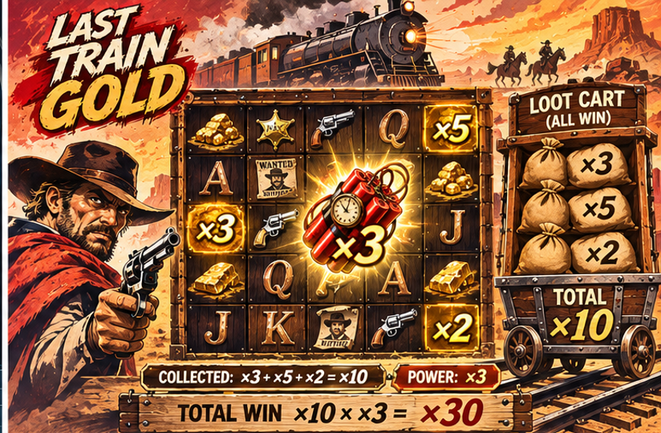
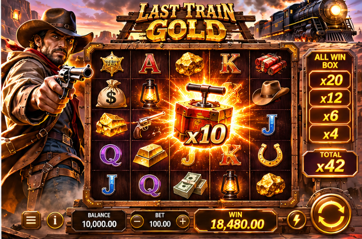

# The Lost Gold Train: Art Direction (v0.1)

Darshan's direction (2026-11-16): **the watercolour look of `art-reference/ref_02_last_train_gold_watercolour.png`**, with its symbols and characters. The reel grids and features in both reference images are **not** used: the game keeps the 5×3 book-style layout and features from `docs/reference-game.md`.

| Reference | Use it for |
| --- | --- |
|  | **Style, palette, characters, props.** Painted, sun-baked, hand-made feel. |
|  | Extra props only (lantern, cowboy hat, horseshoe, cash stack, money bag, nugget). **Not** its glossy 3D rendering. |

Both references are titled "Last Train Gold"; the game's name is **The Lost Gold Train** (open question below).

## 1. Style
- **Medium:** hand-painted watercolour and ink. Loose wet-on-wet washes, pigment blooms and hard dried edges; bold, slightly rough dark-brown ink outlines; visible cold-press paper grain; light dry-brush highlights. It should feel like a painted Western illustration, not a 3D render.
- **Palette:** burnt orange, ochre, rust and sienna (sunset desert); warm cream paper whites; deep sepia and charcoal for ink and shadows; **gold** (yellow ochre to cadmium yellow with white highlights) only on valuable things, so they read as precious; one cool accent (dusty teal or slate blue) for steel, revolvers and night.
- **Light:** low sun from the left; warm rim light; soft long shadows.
- **Mood:** dusty frontier adventure: a gang chases the last gold train through the canyon at sunset.
- **Type:** chunky, hand-cut Western display letters in gold with a dark-red brush backing, as in the reference logo. The reels' card ranks use the same carved-wood or gold lettering.

## 2. Symbol set (Book of Tut roles)

The reference game has 4 premiums, 5 card ranks, and the Book (Wild + Scatter). This proposal keeps exactly that, so the published pay table applies unchanged (`docs/reference-game.md` §3).

| Id | Symbol | Book of Tut role | Pays (× bet) 2/3/4/5 | Look |
| --- | --- | --- | --- | --- |
| 0 | **The Outlaw** (the cowboy with the revolver, red bandana) | John Hunter (top) | 1 / 10 / 100 / 500 | bust, three-quarter view, hat brim shadow over the eyes, revolver raised, red bandana |
| 1 | **Sheriff's Star** (gold badge) | Tutankhamun mask | 0.5 / 4 / 40 / 200 | five-point gold star with ball tips, engraved, on a scrap of leather |
| 2 | **Revolver** | Golden cat | 0.5 / 3 / 10 / 75 | Colt-style, steel teal-grey with brass and a wooden grip, angled |
| 3 | **Gold Bars** | Scarab | 0.5 / 3 / 10 / 75 | stacked bars stamped with a train mark, a gleam on the top bar |
| 4–8 | **A, K, Q, J, 10** | card ranks | 3/4/5: A, K 0.5 / 4 / 15; Q, J, 10 0.5 / 2.5 / 10 | carved weathered-wood letters with gold leaf edges; each a different wash colour (A rust red, K sienna, Q dusty teal, J ochre, 10 sage green) |
| 9 | **Dynamite Bundle** (red sticks with a pocket-watch timer) | the Book: Wild + Scatter | 3/4/5 anywhere: 2 / 20 / 200 | the reference's dynamite-and-clock bundle, lit fuse sparking |

**Spare props**, if Darshan prefers them to any symbol above: Wanted poster, Money bag, Gold nugget, Lantern, Cowboy hat, Horseshoe, Cash stack. Adding them as extra symbols changes the maths (unpublished pays, re-tune); swapping them in for a symbol above doesn't.

**Free spins moments** (replacing the book opening):
- **Special symbol pick:** the dynamite blasts open a **train strongbox**. The candidate symbols flicker inside the box and land on the special symbol.
- **Expansion:** the special symbol's reel bursts into a full-reel painted panel. The Outlaw gets **full-reel art** (`sym_00_expanded`, standing on top of a train carriage), like the Fortune Pig in New Year Crackers.

## 3. Screens and other art

| Asset ID | Content |
| --- | --- |
| `bg_base_main` | Canyon at sunset, mesas and dust; the steam train crossing behind the reels; reels framed in weathered timber with iron corner brackets and rivets (as in the watercolour reference). Reel area left plain (dark wood planks), reels centred. |
| `bg_freegame_main` | Same frame, **night**: moonlit canyon, the train with lit windows on a trestle bridge, distant riders, cooler teal and indigo washes with warm lamp light. |
| `fx_scatter_full` | Full-reel dynamite: a bundle at the top, fuse running down the reel, sparks; it reveals down the reel when free spins trigger. |
| `fx_lantern` | Hanging railway lantern (anticipation lights, modal decoration). |
| `banner_win_*` | Painted wooden signboards with gold Western lettering: NICE WIN, BIG WIN, MEGA WIN, SUPERB WIN, SENSATIONAL WIN, EPIC WIN; gold dust and coins around them. |
| `ui_splash_logo` | "THE LOST GOLD TRAIN" logo: chunky gold Western letters on a red brush stroke, with a small locomotive. |
| Side character (optional) | The Outlaw, full body, beside the reels on the left as in the references (part of the background, or a separate layer for idle animation). |

## 4. Prompts for generating the art

The base style line goes at the start of every prompt:

> *Hand-painted watercolour and ink illustration for a Wild West slot game, loose wet-on-wet washes, pigment blooms, bold rough dark-brown ink outlines, visible cold-press paper texture, warm sunset palette of burnt orange, ochre, rust and sienna, gold highlights, low sun from the left, no text, no watermark.*

**Symbols:** add *"single centred object, game icon, isolated on a plain white background, soft painted edge, square 2048×2048"*. Then cut out the white with `tools/asset-pipeline/cut_backgrounds.py`.

| File to save in `art/symbols/` | Prompt (after the base style line and symbol suffix) |
| --- | --- |
| `sym_00_idle.png` | Rugged outlaw cowboy, bust, three-quarter view, wide-brim dusty brown hat shading his eyes, red bandana, stubble, raising a revolver towards the viewer, framed in a weathered wooden plaque with iron rivets |
| `sym_00_expanded.png` | Same outlaw, full body, standing on the roof of a moving train carriage, coat blowing, revolver in hand, tall vertical composition 1:2.5 |
| `sym_01_idle.png` | Gold five-point sheriff's star badge with ball tips, engraved "SHERIFF", pinned to a scrap of worn leather, gleaming |
| `sym_02_idle.png` | Antique Colt revolver, steel with teal-grey sheen, brass details, worn wooden grip, angled 30 degrees |
| `sym_03_idle.png` | Stack of three gold bars stamped with a small locomotive mark, bright gleam on the top bar |
| `sym_04_idle.png` (A), `sym_05_idle.png` (K), `sym_06_idle.png` (Q), `sym_07_idle.png` (J), `sym_08_idle.png` (10) | Letter "A" (K / Q / J / 10) carved from weathered wood with gold-leaf edges, colour wash in rust red (sienna / dusty teal / ochre / sage green) |
| `sym_scatter_idle.png` | Bundle of red dynamite sticks tied with rope, a brass pocket-watch timer strapped on the front, lit fuse throwing sparks, glowing |

**Backgrounds** (save in `art/backgrounds/`, landscape 16:9, at least 1920×1080):
- `bg_base_main.png`: *wide desert canyon at sunset, red mesas, a black steam locomotive with carriages crossing in the distance with smoke trail, foreground a large frame of weathered timber planks with iron brackets and rivets around an empty dark-wood panel in the centre (reel area, 5 columns × 3 rows, about 78% of the width and 72% of the height), empty, no symbols, no UI*
- `bg_freegame_main.png`: *the same scene at night, full moon, the train with glowing windows on a wooden trestle bridge, riders silhouetted on the ridge, indigo and teal washes with warm lamp light, same empty timber frame in the centre*

**Effects and UI** (save in `art/fx/`, `art/banners/`, `art/ui/`, white background):
- `fx_scatter_full.png`: *tall vertical strip 1:2.5: dynamite bundle with pocket-watch timer at the top, a long burning fuse snaking down the whole height, sparks*
- `fx_lantern.png`: *old railway lantern with a red glass and a warm flame, hanging from a hook*
- `banner_win_big.png` (and `_nice`, `_mega`, `_superb`, `_sensational`, `_epic`): *wooden signboard with chunky gold Western letters "BIG WIN" on a red brush stroke, gold dust and coins flying*
- `ui_splash_logo.png`: *logo "THE LOST GOLD TRAIN", chunky gold Western display letters with dark outline on a red brush stroke, small steam locomotive behind the letters*

Upload the files on GitHub (repo → `art/` → Add file → Upload files) named exactly as above, under 25 MB each.

## 5. Decisions (Darshan, 2026-11-16)
1. Name: **The Lost Gold Train**.
2. Symbols match the reference game's roles, using the art pack: the set in §2.
3. The Outlaw is the game's **mascot**, standing left of the reels.

## Prototype implementation status
- Delivered and in the game: all symbols, the Dynamite, the mascot and the full-reel Outlaw, from `Last_Train_Gold_Separated_Assets.zip` (see `docs/game-asset-specification.md`).
- Still needed: both backgrounds, the win banners, the logo and the hanging lantern (prompts in §4).
